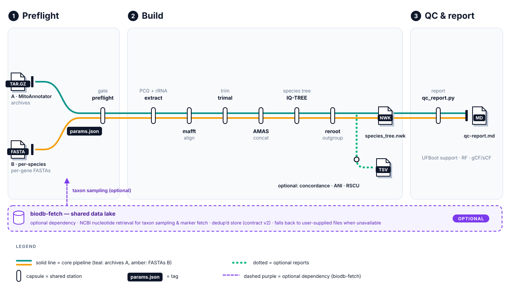

# mitotree-agent

[](#-installation)
[](#-installation)
[](https://github.com/cheahhl814/skill-forge)

Agentic mitogenome phylogenomics pipeline (multi-gene supermatrix — extract PCGs+rRNA, align, trim, concatenate, species tree) with optional gene-tree concordance, ANI, and codon-usage branches. Rebuilt from the MitoTree Nextflow pipeline as a checkpointed BettaMt-pattern skill. Deliberately excludes divergence-time dating (MCMCtree/PAML) — unreliable from mitogenome-only data.

**Repository**: https://github.com/cheahhl814/mitotree-agent

> [!NOTE]
> Current version: **v1.2.0** (updated 2026-11-16).

## Contents

- [Installation](#-installation)
- [Usage](#-usage)
- [Pipeline overview](#-pipeline-overview)
- [Tools](#-tools)
- [Update check](#-update-check)
- [Repository layout](#-repository-layout)
- [Hard guarantees](#-hard-guarantees)
- [Provenance](#-provenance)
- [License](#-license)

## 🚀 Installation

This is an **agent skill**, not a user-facing library. The recommended install path is to let your AI agent import it.

**Option A — give your agent this prompt (recommended):**

```text
Install the mitotree-agent skill from
https://github.com/cheahhl814/mitotree-agent —
clone it into your agent's skills directory (the path your agent watches
for skills) and run `pixi install` from that directory. Then read the
skill's SKILL.md to understand its phases and the Input/Output contract
for each. Confirm when the environment is ready.
```

**Option B — manual install:**

```bash
git clone https://github.com/cheahhl814/mitotree-agent.git
cd mitotree-agent
pixi install
```

> [!TIP]
> `pixi install` resolves every tool from `pixi.toml` (channels: conda-forge, bioconda) into an isolated `.pixi/` environment. The exact resolved versions are pinned in the committed `pixi.lock`, so a fresh clone reproduces the tested toolchain. Platform coverage is `linux-64` only — bioconda does not carry all of AMAS/IQ-TREE/fastANI for macOS.

## 💡 Usage

The skill is designed to be driven by an AI agent: the agent reads the master `SKILL.md`, detects the current phase from the filesystem state of your run directory, and routes to the right sub-skill.

### Natural-language prompts that trigger the skill

```text
mitogenome phylogenomics
mitotree
mitogenome supermatrix
build a mitogenome tree
gene concordance factors
```

### Manual phase execution

If you prefer to drive the phases yourself (or want to re-run a single phase):

```bash
# Set your run directory (all phase artifacts land here)
RUN_DIR=/path/to/run-dir

pixi run preflight   # Phase 1 — validate inputs, write preflight.md + params.json
pixi run run         # Phase 2 — execute the workflow (after preflight ≥ GO)
pixi run qc          # Phase 3 — build the final report (after run completes)
pixi run debug       # On failure — interpret stderr via the signature library
pixi run battle-test # Structural quality gate (skill maintenance)
```

> [!IMPORTANT]
> Each phase has an explicit **Inputs/Outputs contract** at the top of its sub-skill `SKILL.md`. If the upstream artifact is missing (e.g. you run `run` before `preflight` passed), the sub-skill refuses to proceed and tells you which phase to run first. Phases are gated on purpose — don't skip them.

## 🔬 Pipeline overview



*Mitogenome inputs merge into one trunk through preflight → build → QC; the dotted spur marks the optional concordance/ANI/RSCU reports; the dashed purple rail is the optional `biodb-fetch` dependency (shared data lake), feeding the taxon-sampling input — it falls back to user-supplied files when unavailable.*

Phases run in order: **preflight → build → qc**. Everything else is optional and user-triggered.

| # | Phase | What it does | Sub-skill | Artifact |
|:--|:------|:-------------|:----------|:---------|
| 1 | Preflight | Validate inputs (archives or per-gene FASTAs), gene coverage, tool audit; write `params.json` | `preflight/mitotree-preflight` | `preflight.md`, `params.json` |
| 1a | Taxon sampling *(optional, pre-preflight)* | Fetch complete mitogenomes from NCBI (primary submissions), BLASTN-extract 13 PCGs + 12S/16S | `preflight/mitotree-taxon-sampling` | `taxon_sampling/genes/*.genes.fasta` |
| 2 | Build | Extract → align (MAFFT) → trim (trimAl) → concatenate (AMAS) → species tree (IQ-TREE) → re-root | `build/mitotree-builder` | `build/species_tree.nwk` |
| 3 | QC | Supermatrix stats, UFBoot support, folds in optional branch outputs below | `qc/mitotree-qc` | `qc-report.md` |
| — | Concordance *(optional)* | Per-gene trees, RF distances, gCF/sCF; optional gCF-vs-sCF scatter figure | `concordance/mitotree-concordance` | `concordance/rf_distances.tsv`, `concordance.cf.stat` |
| — | ANI *(optional)* | fastANI near-identity screen + heatmap | `ancillary/mitotree-ani` | `ani/fastani_results.tsv` |
| — | Codon usage *(optional)* | RSCU (nucleotide-mode input only) | `ancillary/mitotree-codon-usage` | `codon_usage/rscu.tsv` |
| — | Prune *(optional)* | Keep/exclude taxa, or diff against a reference tree | `prune/mitotree-prune` | `pruned/species_tree_pruned.nwk` |
| — | Visualize *(optional)* | iTOL annotation datasets (italic labels, colorstrip), or offline SVG/PDF/PNG figure | `visualize/mitotree-itol`, `visualize/mitotree-render` | `itol/`, `figures/species_tree.{svg,pdf,png}` |
| — | Debug *(on failure)* | Signature-library interpreter for stderr/exit codes | `debug/mitotree-debug` | `debug-report.md` |
| — | Battle-test *(maintenance)* | Structural gate for the skill itself (frontmatter, docs-corpus, git hygiene) | `battle-test/mitotree-battle-test` | `battle-test-report.md` |

> [!TIP]
> Read each sub-skill's `SKILL.md` for the full procedure, its ask-user stop points, and its signature library (stderr pattern → cause → fix).

## 🧰 Tools

All tools resolve from conda-forge/bioconda via `pixi.toml`; exact versions are locked in the committed `pixi.lock`.

| Tool | Role |
|:-----|:-----|
| `mafft` | Multiple sequence alignment |
| `trimal` | Alignment trimming (gappy/gap-only columns) |
| `amas` | Alignment statistics + supermatrix concatenation (`AMAS.py`) |
| `iqtree` | Species/gene trees (IQ-TREE 2, UFBoot, gCF/sCF) |
| `gotree` | Tree manipulation (prune, reroot, RF distance, tip stats) |
| `r-ape` / `r-getopt` | R re-rooting of the species tree (build step) |
| `fastani` | Average nucleotide identity (ANI) screen |
| `blast` | `makeblastdb` + `blastn` gene extraction (taxon sampling) |
| `entrez-direct` | E-utilities retrieval of NCBI mitogenome records |
| `vsearch` | Near-duplicate collapse (`--cluster_fast`) |
| `toytree` (+ `toyplot`) | Offline figure rendering |
| `biopython` | FASTA parsing / RSCU calculation |
| `pandas` / `numpy` / `scipy` | QC tables, heatmap clustering |
| `matplotlib` | ANI heatmap |

Tool usage is grounded in the offline `docs-corpus/` snapshots (version-matched `--help` captures, upstream repo docs) — the agent reads these instead of guessing flags. The Python libraries above are imported directly and are not separately wrapped in `docs-corpus/`.

## 🔄 Update check

Every skill built with [skill-forge](https://github.com/cheahhl814/skill-forge) ships a self-update check that compares the deployed git SHA against this upstream repo via `git fetch` — no GitHub API call, no extra dependencies.

```bash
pixi run update-check
```

| Verdict | Exit | Meaning |
|:--------|:-----|:--------|
| `UP-TO-DATE` | 0 | Local HEAD matches origin/HEAD |
| `LOCAL-AHEAD` | 0 | Unpushed local commits; no action needed |
| `BEHIND-BY-N` | 1 | Upstream is N commits ahead → re-pull/re-sync from this repo |
| `OFFLINE` | 2 | `git fetch` failed; informational only |
| `NO-ORIGIN` | 2 | No `origin` remote configured; informational only |

## 📁 Repository layout

```text
mitotree-agent/
├── SKILL.md                  # Master orchestrator (router — start here)
├── README.md                 # This file
├── LICENSE                   # MIT
├── pixi.toml                 # Tool dependencies (conda-forge/bioconda)
├── pixi.lock                 # Locked resolutions (committed — do not hand-edit)
├── params.json               # Build provenance (versions, tool inventory, sub-skills)
├── bin/
│   └── skill-update-check.py # Self-update check (pixi run update-check)
├── docs-corpus/              # Offline snapshots: mafft, trimal, amas, iqtree, gotree,
│                             #   fastani, blast, entrez-direct, vsearch, toytree
├── preflight/                # mitotree-preflight (+ mitotree-taxon-sampling)
├── build/                    # mitotree-builder
├── qc/                       # mitotree-qc
├── concordance/              # mitotree-concordance
├── ancillary/                # mitotree-ani, mitotree-codon-usage
├── prune/                    # mitotree-prune
├── visualize/                # mitotree-itol, mitotree-render
├── debug/                    # mitotree-debug
└── battle-test/              # mitotree-battle-test (structural gate)
```

## 🔒 Hard guarantees

- **Filesystem evidence chain** — every phase emits the artifact the next phase consumes; the boundary between phases is the filesystem, not agent memory.
- **Docs-grounded tool usage** — tool flags come from `docs-corpus/`, never from the agent's memory.
- **Explicit stop points** — ambiguous decisions are surfaced to you as *Evidence + Recommend + Options*, not auto-picked.
- **Reproducible environments** — tools resolve from `pixi.toml` and are pinned in the committed `pixi.lock`.

## 🚀 Nextflow runner

This skill does not currently ship a Nextflow runner. For cohort/HPC execution, wrap the `pixi run` tasks in a workflow scheduler of your choice.

## Provenance

Built with the [skill-forge](https://github.com/cheahhl814/skill-forge) meta-skill, following the AiX-BIO skill convention (preflight → build → debug → battle-test evidence chain). Pattern adopted from:

- **BettaMt-agents** — https://github.com/cheahhl814/BettaMt-agents
- **bacterial-genome-analysis** — https://github.com/cheahhl814/bacterial-genome-analysis
- **amr-gene-screening** — https://github.com/cheahhl814/amr-gene-screening

Divergence-time dating (MCMCtree/PAML) is deliberately out of scope — mitogenome-only data does not reliably calibrate node ages. Use a nuclear multi-locus or genome-scale dataset with MCMCtree instead.

## License

MIT — see [LICENSE](LICENSE).
